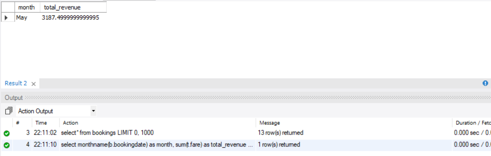
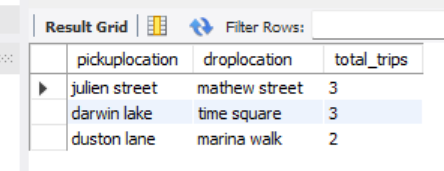
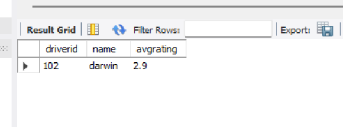
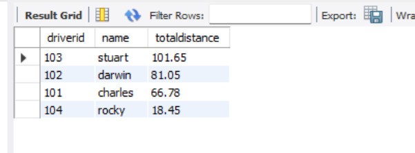

# Cab_Booking_Analysis_SQL
SQL project demonstrating joins, aggregate functions, subqueries, and CTEs

## Project Overview

This project demonstrates SQL skills by analyzing a Cab booking system

## Skills Used
SELECT  
WHERE  
GROUP BY  
ORDER BY  
JOINS  
Subqueries  
Common Table Expressions (CTEs)  
Aggregate Functions  

## Sample Queries
#### 1. Total revenue generated by completed bookings  
   select monthname(b.bookingdate) as month, sum(t.fare) as total_revenue  
   from bookings b  
   join tripdetails t on b.bookingid=t.bookingid  
   where (b.status="completed") group by monthname(b.bookingdate);  
     

#### 2. Top 3 travelled routes based on locations  
   select pickuploaction, droplocation, count(*) as total_trips  
   from bookings b  
   group by pickuploaction, droplocation  
   order by total_trips desc limit 3;  
     

#### 3. Drivers with average rating below 3.0  
select d.driverid, d.name, round(avg(f.rating),2) as avgrating  
from drivers d  
join cabs c on d.driverid=c.driverid  
join bookings b on c.cabID=b.cabId  
join feedback f on b.bookingID=f.bookingID  
where f.rating is not null  
group by d.driverid, d.name  
having avgrating<3;  

#### 4. Top drivers completed longest trips  
select d.driverid, d.name, round(sum(tripdetails.distanceKM),2) as totaldistance  
from drivers d  
join cabs c on d.driverid=c.driverid  
join bookings b on c.cabID=b.cabID  
join tripdetails on b.bookingid=tripdetails.bookingid  
where b.status="completed"  
group by d.driverid, d.name  
order by totaldistance desc  
limit 5;  
  

## Tools Used
-MySQL  
-MySQL Workbench  
-GitHub  
   
